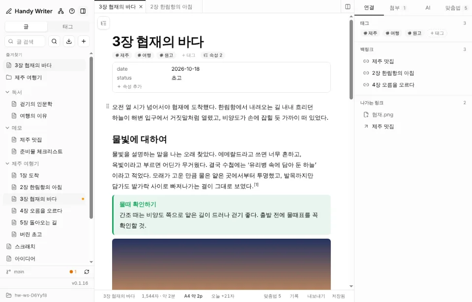
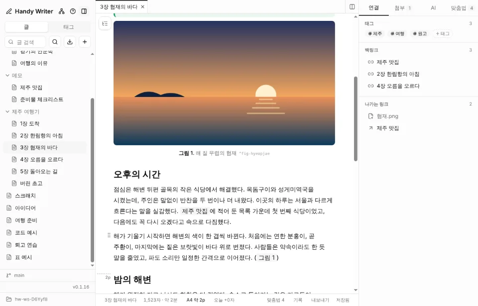
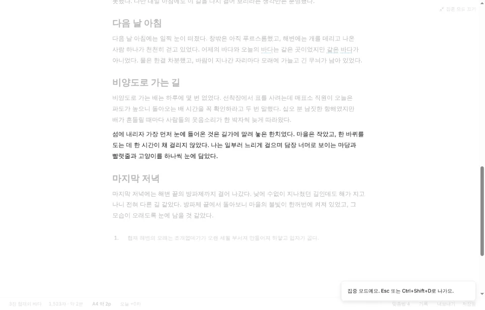
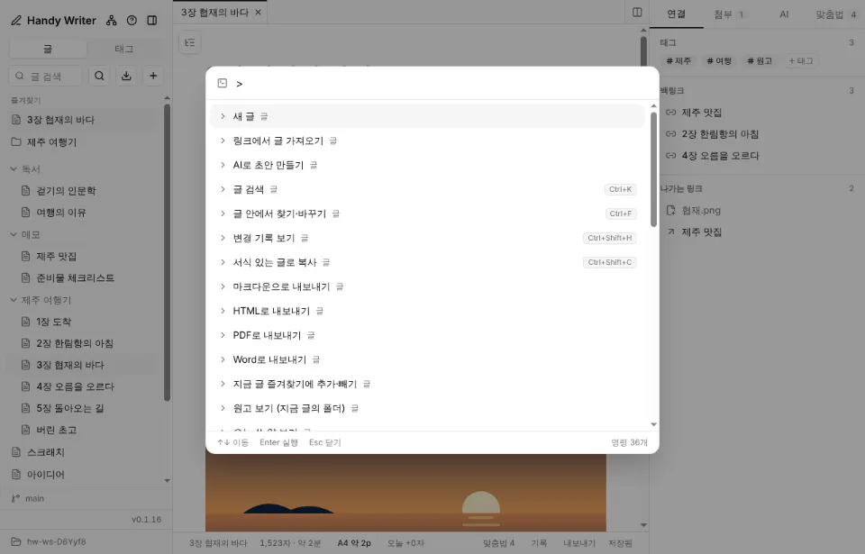
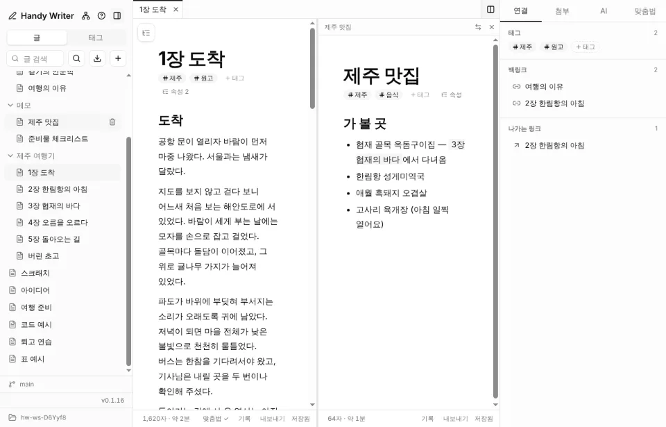
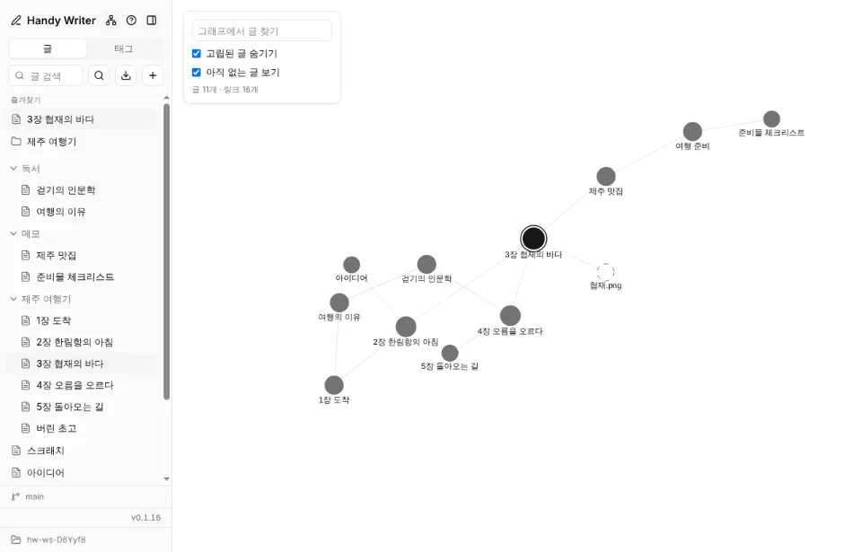
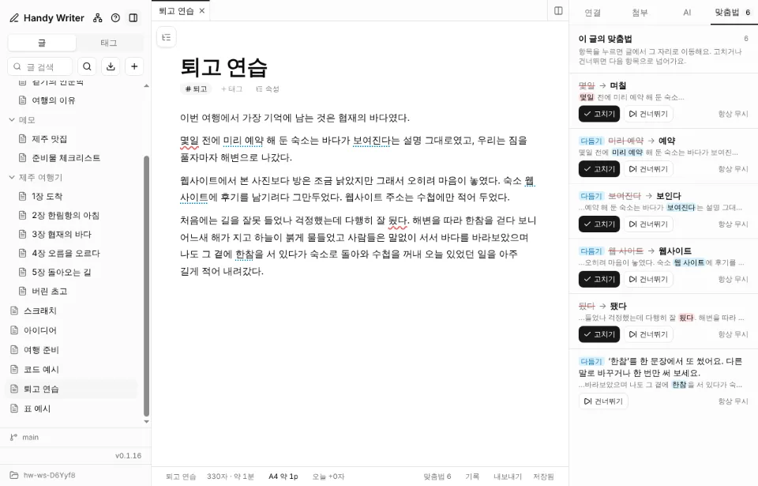
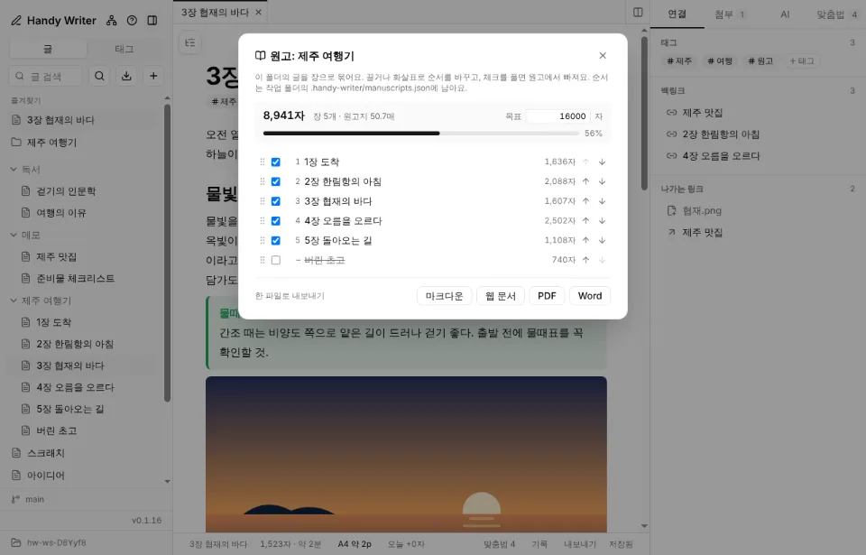
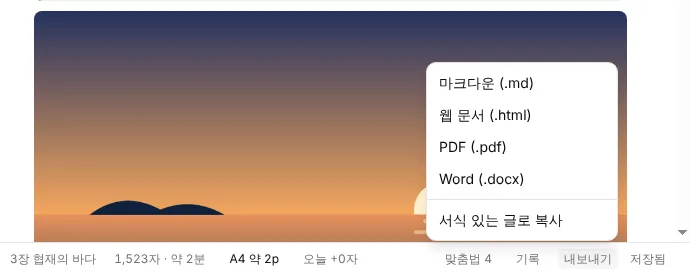
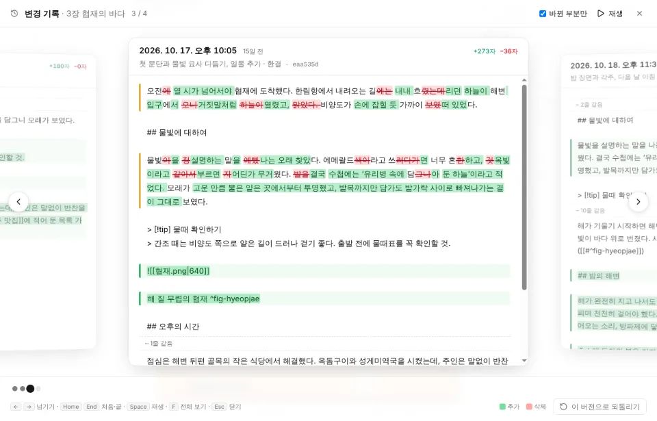

# Handy Writer

글쓰기를 도와주는 로컬 우선 데스크톱 앱. 글은 작업 폴더의 마크다운(`.md`) 파일로 저장돼서 Obsidian이나 git과 그대로 같이 쓸 수 있어요.

<p align="center"></p>

- **파일 그대로**: 작업 폴더의 `.md`를 그대로 읽고 써요. 손대지 않은 부분은 원문 그대로 저장해서 git 변경 기록이 깔끔해요.
- **긴 글을 위한 도구**: 폴더를 장으로 묶는 원고, A4 페이지 수와 구분선, 오늘 쓴 양과 연속 기록, 글자·원고지 목표 분량.
- **한국어 글쓰기**: 맞춤법, 문장 다듬기, 표기 통일, 200자 원고지 매수.
- **되돌릴 수 있게**: git 커밋마다 버전을 카드로 넘겨 보고, 저장 실패·바깥 변경 충돌에서도 글을 지켜요.
- **연결해서 쓰기**: `[[위키링크]]`, 백링크, 태그와 태그 추천, 그래프, 다른 글 끼워 넣기(`![[글#소제목]]`).
- **내보내기**: 마크다운, HTML, PDF, Word(.docx), 서식 있는 복사. PDF·Word는 종이·글자 크기·줄 간격·여백·쪽 번호·제목 유무를 고르고 쪽마다 미리 볼 수 있어요.
- **AI는 선택**: 컴퓨터의 Claude Code CLI를 그대로 써서 API 키가 필요 없어요.

## 시작하기

- **설치**: [Releases](https://github.com/gyeongseokKang/handy-writer/releases)에서 맥용 설치 파일(dmg)을 받아요. 처음 열 때 경고가 뜨면 아래 [설치 파일과 자동 업데이트](#설치-파일과-자동-업데이트)를 보세요.
- **개발**: `pnpm install` 뒤 `pnpm dev`.
- 처음 실행하면 짧은 시작 안내가 뜨고, 작업 폴더를 고르면(Obsidian 볼트도 돼요) 바로 쓸 수 있어요. 기능은 사이드바 위의 **도움말(`?` 아이콘, `F1`)**에 그림과 함께 모여 있고, `Ctrl/Cmd+Shift+P` 명령 팔레트와 `Ctrl/Cmd+/` 단축키 안내에서도 찾을 수 있어요.

## 기능

### 글쓰기

노션처럼 편하게 쓰고, 파일은 마크다운 그대로 남아요.

<p align="center"></p>
<p align="center"><sub>아래 막대의 <code>A4 약 3p</code>와 페이지가 넘어가는 자리의 점선 · <code>2p</code>. PDF로 내보낼 때와 같은 기준으로 세요.</sub></p>

<p align="center"></p>
<p align="center"><sub>집중 모드(<code>Ctrl/Cmd+Shift+D</code>): 지금 쓰는 문단만 진하게, 커서 줄은 화면 가운데에.</sub></p>

- 작업 폴더 선택 (Obsidian 볼트, git 저장소 폴더도 그대로 사용 가능)
- 노션 같은 에디터: `/` 블록 메뉴, 블록 드래그 핸들, 선택 서식 툴바, 할 일·표·코드 블록
- 블록 종류 바꾸기: 이미 쓴 글도 본문, 제목 1~3, 할 일·글머리·번호 목록, 인용, 코드 블록으로 바꿔요(새 블록을 만들지 않고, 목록·인용 안에서도 돼요). 블록 왼쪽 ⋮⋮ 손잡이를 누르면 종류 바꾸기·복제·삭제 메뉴가 뜨고(끌면 옮겨요), 글자를 선택하면 뜨는 막대의 맨 왼쪽 칸에서도 바꿔요(선택한 채로 `Tab`을 누르면 이 메뉴가 열리고 포커스가 옮겨 가서 화살표·Enter로 고르고 Esc로 돌아와요. 목록·코드 블록 안에서는 Tab이 원래대로 들여쓰기). 막대의 버튼에 마우스를 올리면 이름과 단축키가 바로 보여요. 빈 제목 블록에는 ‘제목 2’처럼 단계가 보여요
- 블록 단축키(Notion과 같은 번호): `Ctrl/Cmd+Alt+0` 본문, `1~3` 제목, `4` 할 일, `5` 글머리 목록, `6` 번호 목록, `7` 인용, `8` 코드 블록. `Ctrl/Cmd+Shift+↑↓` 블록 위·아래로 옮기기, `Ctrl/Cmd+D` 블록 복제, `Ctrl/Cmd+Shift+V` 서식 없이 붙여넣기(Electron 기본 메뉴에는 없어서 앱이 직접 처리해요)
- `[[위키링크]]` (`[[` 자동완성, 클릭 이동), Obsidian 콜아웃(`> [!note]`)
- frontmatter는 에디터에 보이지 않고 저장할 때 그대로 보존
- 오늘 쓴 양: 아래 막대의 `오늘 +1,240자`. 이 앱에서 저장한 글마다 그날 처음보다 늘어난 글자 수를 더해요(자동 저장이 잦아도 두 번 세지 않음). 누르면 연속으로 쓴 날, 하루 목표와 진행률, 최근 18주 잔디 달력, 최근 7일 합계를 보여 줘요. 기록은 이 컴퓨터의 앱 데이터 폴더에만 남아요
- 본문 첫 제목(`# …`)이 글 제목과 같으면 위쪽 제목이 대신해서 본문에서는 숨겨요 (파일은 그대로예요). 글 제목을 바꾸면 그 줄도 같이 바뀌어서 어긋나지 않고, 목차와 HTML·PDF·Word로 내보낼 때도 제목이 두 번 나오지 않아요
- 목차: 에디터 왼쪽 위에 떠 있고, 평소에는 지금 읽는 제목(스크롤·커서를 따라감)과 그 위 제목들(h1 → h2 → h3)만, 마우스를 올리면 전체 목록이 보여요. 누르면 그 제목으로 이동. 펼친 목차 위의 핀 버튼(또는 설정)으로 마우스를 올리지 않아도 전체 목차를 펼친 채로 고정할 수 있어요(이 컴퓨터에 기억). 설정이나 명령 팔레트(`목차 보이기·숨기기`)로 켜고 끔
- 글 너비: 글 칸 양옆 가장자리에 흐린 ↔ 손잡이가 있어요. 한쪽을 끌면 가운데를 기준으로 반대쪽도 같이 넓어지거나 좁아지고(480px~), 이 컴퓨터에 기억해요. 창이 그보다 좁으면 창에 맞춰 줄어들고, 손잡이를 두 번 누르면 기본 너비(768px)로 돌아가요
- 사이드바·오른쪽 패널 너비: 가장자리 가운데의 흐린 ↔ 손잡이를 끌어 바꾸고 이 컴퓨터에 기억해요(사이드바 200~480px, 오른쪽 패널 260~640px). 두 번 누르면 기본 너비(256px·320px)로 돌아가요. 글 너비를 포함해 끄는 동안에는 Word처럼 칸 위에 눈금자와 지금 너비(px)가 흐리게 보여요. 오른쪽 패널은 탭 막대 오른쪽 끝(패널 바로 옆) 버튼으로 접고 펴요
- 코드블록: 펜스에 적은 언어(```tsx 등)대로 문법 색을 입히고, 머리줄에서 언어를 바꾸거나 코드를 복사해요. 라이트·다크 테마를 따라가요
- 첨부 탭: 이 글의 이미지·영상·오디오·PDF를 한 줄씩 접어서 보여주고, 눌러서 펼치면 미리보기와 라벨(캡션) 수정. 너비·높이는 '크기 조정'에 따로 있고, 크기를 정하지 않으면 항상 글 폭 100%로 표시. 붙여넣기, 끌어다 놓기, `/이미지·영상·파일`, `첨부 추가`로 `attachments/` 에 저장
- 이미지 나란히 놓기: 이미지를 여러 장 한꺼번에 붙이거나 끌어다 놓거나, 이미 이미지가 있는 줄에 하나 더 올리면 한 줄(최대 3칸, 4장은 2×2)에 나란히 놓고, 아래에 `그림 N.` 라벨 줄을 만들어 묶음 설명을 쓰게 해요. 명령 팔레트의 `이미지 나란히 놓기`·`나란히 놓은 이미지 풀기`로 이미 넣은 이미지도 묶고 풀 수 있고, 묶음을 우클릭하면 `그룹 해제`가 떠요. PDF·Word 내보내기에도 같은 모양으로 나와요 (파일에는 `![[a.png]] ![[b.png]]`처럼 한 문단으로 남아 Obsidian에서도 읽혀요)
- 첨부 문법은 Obsidian 호환: `![[파일.png|라벨|300]]`, `![[파일.png|300x200]]`, 일반 마크다운 `` (읽은 문법 그대로 다시 씀)
- 글 끼워 넣기 (Obsidian 호환): `![[다른 글]]`은 그 글 전체를, `![[다른 글#소제목]]`은 그 소제목의 절만 본문 안에 읽기 전용으로 보여 줘요. 그 글이 저장되면 다시 읽고, 머리의 버튼으로 그 글을 열어요. HTML·PDF·Word로 내보내면 끼워 넣은 내용이 그대로 펼쳐져요
- 글 안에서 찾기·바꾸기(`Ctrl/Cmd+F`): 일치하는 곳을 모두 칠하고 Enter/Shift+Enter로 오가요. 대소문자 구분, 바꾸기, 모두 바꾸기(한 번에 되돌리기 가능). Esc로 닫아요
- 글자 수와 목표 분량: 아래 막대에 글자 수와 읽는 시간(선택하면 선택한 글자 수). 누르면 공백 제외 글자 수와 200자 원고지 매수(문단마다 첫 칸 비우기 규칙)를 보여주고, 목표 분량(글자 또는 원고지 매수)을 정하면 frontmatter에 `goal: 3000` / `goal: 15매`로 저장하고 진행률 막대를 보여줘요
- A4 페이지 수와 구분선: 아래 막대의 `A4 약 5p`는 PDF로 내보냈을 때의 페이지 수예요. 한글·Word 기본값(글자 10pt, 줄 간격 160%, 여백 20mm)이라 한 페이지에 2,000자쯤(200자 원고지 10매) 들어가요. 같은 문서·CSS로 보이지 않게 그려서 세고, 줄을 반으로 자르지 않고 문단의 첫·끝 두 줄이 홀로 남지 않게 하는 인쇄 규칙도 따라요. 페이지가 넘어가는 자리마다 글 왼쪽 여백에 짧은 점선과 `2p`처럼 다음 페이지 번호를 보여 주고, 버튼을 누르면 구분선을 켜고 꺼요
- 집중 모드(`Ctrl/Cmd+Shift+D`, 명령 팔레트 `집중 모드`, 설정): 사이드바·탭·오른쪽 패널·떠 있는 목차를 숨기고 글만 보여 줘요. 지금 쓰는 문단만 진하게 하고 나머지는 옅게 보이며(글 내용은 그대로), 키보드로 쓰거나 움직이면 커서 줄이 늘 화면 가운데쯤에 있게 글이 따라 움직여요(타자기 스크롤. 마우스로 누른 자리는 화면을 움직이지 않아요). 아래 막대와 태그 줄은 옅게 두고 마우스를 올리면 보여요. 열린 창이 없을 때 `Esc`나 구석의 버튼으로 나가요. 문단 강조와 타자기 스크롤은 설정에서 따로 끌 수 있고 이 컴퓨터에 기억해요
- 표 편집: 표 안에 커서를 두면 위에 막대가 떠서 행·열 추가/삭제, 머리글 행, 표 삭제
- 그림·표 번호와 참조 (Obsidian 블록 ID 호환): 그림이나 표 아래 문단 끝에 `^fig-이름`·`^tbl-이름`을 붙이면(`/그림 번호`, `/표 번호`) 앞에 "그림 1.", "표 1."이 붙고, 본문에서 `[[#^fig-이름]]`(`[[#`로 고르기)이라고 쓰면 "그림 1"로 보여요. 순서가 바뀌면 번호와 참조가 함께 바뀌고, 참조를 누르면 그 캡션으로 가요. HTML·PDF로 내보내도 번호가 그대로 나오고, 각주도 화면과 같은 번호로 나가요
- 각주 (Obsidian 호환 `[^1]`, `[^이름]: 내용`): `/각주`로 커서 자리에 다음 번호를 넣고 글 끝에 내용 줄을 만들어요. 본문에는 나온 순서대로 번호가 위첨자로 보이고, 올리면 내용을, 누르면 내용 줄로, 내용 줄 번호를 누르면 본문 자리로 돌아가요. 내용이 없는 각주는 빨갛게 표시해요

### 정리하고 찾기

글이 많아져도 금방 찾고, 연결해서 봐요.

<p align="center"></p>
<p align="center"><sub>명령 팔레트(<code>Ctrl/Cmd+Shift+P</code>): 모든 기능을 이름으로 찾아 실행하고 단축키도 확인해요.</sub></p>

<p align="center"></p>
<p align="center"><sub>분할 화면: 두 글을 나란히 열어 놓고 양쪽 모두 편집해요. 칸이 좁으면 아래 막대가 알아서 줄어요.</sub></p>

<p align="center"></p>
<p align="center"><sub>글과 <code>[[링크]]</code>를 그래프로 봐요.</sub></p>

- 사이드바: 폴더 트리, 글 검색, 새 글, 삭제(휴지통)
- 전체 검색 (`Ctrl/Cmd+K` 또는 `Ctrl/Cmd+P`): 제목·태그·본문 검색, 일치한 단어 강조, 결과를 열면 그 단어로 이동, 입력이 없으면 최근 글 이 글의 태그, 백링크, 나가는 링크 (없는 글은 눌러서 바로 생성)
- 명령 팔레트: `Ctrl/Cmd+K` 검색 창에 `>`를 입력하거나 `Ctrl/Cmd+Shift+P`로 열면 모든 명령(새 글, 찾기, 변경 기록, 내보내기, 탭, 패널, 설정…)을 이름으로 찾아 실행해요. 단축키도 함께 보여요
- 도움말(사이드바 위 `?` 아이콘, `F1`): 에디터가 제공하는 기능을 묶음별로 그림과 함께 설명해요. 기능 이름이나 낱말로 찾고, `지금 써 보기`로 바로 실행해 볼 수 있어요. 그림은 webp로 줄여 앱에 함께 넣었어요
- 단축키 안내(`Ctrl/Cmd+/`)와 설정(`Ctrl/Cmd+,`): 설정 한 곳에서 작업 폴더, 글 너비, 목차·오른쪽 패널, 맞춤법·문장 다듬기, AI 글쓰기 룰·Git 설정, 업데이트를 다뤄요. 처음 실행하면 짧은 시작 안내가 뜨고, 설정에서 다시 볼 수 있어요
- 제목 아래 태그: 글 제목 바로 아래에 태그가 보이고, `+ 태그`로 기존 태그 추천을 받아 더해요
- 글 속성: 태그 줄의 `속성`을 누르면 frontmatter(날짜, 상태, 출처 등)를 표로 보고 고쳐요. 값 고치기, 예/아니오는 체크 상자, 목록은 쉼표로, 이름 바꾸기·지우기·새 속성 더하기. 주석과 따옴표, `[a, b]` 같은 모양은 그대로 둬요
- 즐겨찾기: 글 목록 우클릭 `즐겨찾기에 추가`(글과 폴더)로 사이드바 맨 위에 고정해요. 끌어서 순서를 바꾸고, 폴더를 누르면 목록에서 펼쳐 보여 줘요. 이름을 바꾸거나 옮겨도 따라가요 (작업 폴더마다, 이 컴퓨터에 저장)
- 닫은 탭 다시 열기(`Ctrl/Cmd+Shift+T`), 창이 좁아지면 오른쪽 패널을 저절로 접었다가 넓어지면 펼치기, 글 칸 옆에 자리가 없으면 떠 있는 목차를 아이콘으로 줄이기
- 태그 추천: 오른쪽 `연결` 탭의 `+ 태그`를 누르면 작업 폴더의 기존 태그 가운데 이 글에 어울리는 것을 자동으로 골라 보여줘요(본문에 태그 이름이 나오는지, 그 태그가 붙은 글들과 얼마나 비슷한지, 링크로 이어진 글의 태그). 이 글에 자주 나오는 낱말은 새 태그 후보로도 보여줘요. 누르거나 직접 입력하면 frontmatter의 `tags`에 들어가요
- 태그: frontmatter `tags`와 본문 `#태그`(중첩 `#a/b` 포함), 사이드바 태그 탭, 본문 태그 칩 클릭
- 없는 글로 가는 `[[링크]]`는 흐리게 표시
- 그래프 보기: 글과 링크를 force 그래프로 표시 (고립된 글 숨기기, 없는 글 보기, 글 찾기)
- 글 목록 끌어서 옮기기: 글이나 폴더를 다른 폴더 위로 끌어다 놓으면 그 안으로 옮겨지고(안의 글과 하위 폴더도 함께), 목록 빈 곳에 놓으면 맨 위로 나와요. 열어 둔 글·즐겨찾기·원고 순서는 따라가고, 같은 이름이 있으면 옮기지 않고 알려 줘요
- 글 목록 우클릭 메뉴: 글은 이름 바꾸기·복제·다른 폴더로 옮기기·링크(`[[이름]]`)와 경로 복사·Finder에서 보기·휴지통, 폴더는 새 글·새 폴더·이름 바꾸기·Finder에서 보기·휴지통, 빈 곳은 새 글·새 폴더. 이름은 목록에서 바로 고치고(Enter 저장, Esc 취소), 빈 폴더도 목록에 보여요. 열어 둔 글은 옮기거나 폴더 이름을 바꿔도 그대로 열려 있어요
- 글 이름을 바꾸면 다른 글의 `[[링크]]`도 새 이름으로 자동 수정 (섹션, 별칭, 코드 블록 보존)
- 탭: 글 목록에서 그냥 누르면 지금 탭을, Cmd/Ctrl+클릭(가운데 버튼)·우클릭 `새 탭에서 열기`는 새 탭을 열어요. 끌어서 순서 바꾸기, 가운데 버튼·X·`Ctrl/Cmd+W`로 닫기, `Ctrl+Tab`/`Ctrl+Shift+Tab`, `Ctrl/Cmd+1~9`로 이동. 열어 둔 탭은 다시 켜도 남아요
- 분할 화면(최대 3분할): 탭이나 글 목록의 글을 에디터 쪽으로 끌면 놓을 자리에 `여기에 나란히 띄우기`가 보이고, 놓으면 그 자리에 띄워요. 3분할이 가득 찼으면 놓은 자리의 글을 바꿔요. Alt+클릭, 우클릭 `옆에 열기`, `Ctrl/Cmd+\`(분할을 모두 닫거나 옆 탭 띄우기)로도 돼요. 모든 칸이 편집·저장되고, 경계를 끌어 너비를 바꾸고(더블클릭하면 똑같이 나누기), 칸마다 가운데 글과 자리 바꾸기·닫기가 있어요. 찾기 같은 단축키는 마지막으로 만진 쪽에 적용되고, AI·목차·첨부·맞춤법 패널은 가운데 글을 따라가요

### 다듬기

규칙 기반이라 오프라인에서도 바로 알려 줘요.

<p align="center"></p>
<p align="center"><sub>맞춤법(빨간 물결), 문장 다듬기(파란 점선), 표기 통일(<code>웹사이트</code>/<code>웹 사이트</code>)을 한 목록에서 고쳐요.</sub></p>

- 맞춤법: 입력하는 대로 규칙 기반 검사(자주 틀리는 표기 사전, 라이브러리 없음). 온라인이면 문단 텍스트를 다음/네이버 맞춤법 검사기(hanspell)로도 보내 더 넓게 검사하고, 오프라인이면 건너뜀. **기본 켜짐이며 문단이 외부 서비스로 전송되므로** 하단 메뉴에서 끌 수 있음 (코드·URL·#태그는 보내지 않음)
- 맞춤법 탭(오른쪽 `맞춤법`): 이 글의 맞춤법 항목을 앞뒤 글과 함께 모두 보여줘요. 항목을 누르면 글에서 그 자리를 강조하고 스크롤하며, 고치기·건너뛰기(그 자리만)·항상 무시를 하면 다음 항목으로 넘어가요
- 문장 다듬기: 맞춤법과 함께 파란 점선으로 알려 줘요(오프라인, 규칙 기반). 겹말(미리 예약 → 예약), 이중 피동(보여진 → 보인), 번역투(~에 있어서 → ~에서), 두 칸 띄어쓰기는 바로 고칠 수 있고, 너무 긴 문장(100자 넘게), 한 문장 안에서 되풀이한 낱말, 한 문단에서 또 쓴 ‘~것이다’·‘~수 있다’는 알려 주기만 해요. 맞춤법 탭에 ‘다듬기’로 함께 나오고, 아래 막대의 맞춤법 설정에서 끌 수 있어요. `다듬기 설정`에서 규칙별로 켜고 끄고 긴 문장 기준을 바꾸며, 내 표기 사전(작업 폴더의 `.handy-writer/style.md`, 한 줄에 `틀린 말 -> 고친 말`)에 자주 틀리는 내 표기를 넣을 수 있어요 글 전체를 보고 같은 말을 띄어쓰기·하이픈·대소문자만 달리 섞어 쓴 곳(웹사이트/웹 사이트, e-mail/email, JavaScript/Javascript)을 알려 주고, 이 글에서 더 많이(같으면 먼저) 쓴 표기로 바꾸기를 제안해요. 영문 첫 글자만 대문자인 것(문장 맨 앞)은 넘어가고, 다듬기 설정에서 끌 수 있어요

### 가져오기·내보내기·원고

웹 글을 가져오고, 책 한 권 분량의 원고로 묶어 내보내요.

<p align="center"></p>
<p align="center"><sub>폴더를 책 한 권처럼: 장 순서를 끌어서 바꾸고, 전체 분량과 목표 진행률을 보고, 한 파일로 내보내요.</sub></p>

<p align="center"></p>
<p align="center"><sub>마크다운 · 웹 문서 · PDF · Word, 그리고 블로그·메일에 붙여 넣을 서식 있는 복사.</sub></p>

- 링크에서 글 가져오기(사이드바의 가져오기 버튼, 빈 화면, `/링크에서 가져오기`): 블로그·기사 주소를 넣으면 메뉴·광고를 빼고 본문만 뽑아(Readability) 마크다운으로 미리 보여주고, 새 글로 만들거나 지금 글에 넣어요. 스크립트로 그리는 페이지도 읽고, 그림·링크는 원래 주소로 남겨요. 유튜브 주소는 영상 설명과 자막을 가져와요. 원래 주소는 frontmatter의 `source`와 맨 아래 출처 줄에 남아요
- 서식 있는 글로 복사(`내보내기` 메뉴 또는 `Ctrl/Cmd+Shift+C`): 제목·굵게·표·이미지를 살린 HTML과 일반 글을 함께 클립보드에 넣어 블로그·메일에 붙여 넣어요
- 내보내기: 에디터 아래 막대의 `내보내기`로 지금 글을 마크다운(frontmatter 포함), HTML(이미지는 파일 안에 포함, 한 파일로 공유 가능), PDF, Word(.docx)로 저장해요. Word에는 제목·목록·표·코드·인용·그림이 들어가고, 각주는 Word 각주가 되며 그림·표 번호도 그대로 나와요. 영상·오디오·PDF 첨부는 이름만 남아요
- 원고 묶기: 폴더 우클릭 `원고로 보기`(또는 명령 팔레트 `원고 보기`)로 폴더 안의 글을 장으로 묶어요. 끌거나 화살표로 장 순서를 바꾸고, 체크를 풀어 원고에서 빼고, 장별·전체 분량(글자, 원고지)과 원고 목표 분량의 진행률을 봐요. `마크다운`·`웹 문서`·`PDF`·`Word`로 한 파일로 내보내면 장마다 제목이 붙고(본문이 `# 제목`으로 시작하지 않으면 글 이름), 각주와 그림 번호가 장끼리 겹치지 않아요. 순서·뺀 장·목표는 작업 폴더의 `.handy-writer/manuscripts.json`에 남아 git으로 함께 관리되고, 글 이름을 바꾸거나 옮겨도 따라가요
- 핸디 리뷰로 게시: 글 속성에 `review`를 더하면(속성 표의 `+ 속성 추가`, 명령 팔레트 `이 글을 핸디 리뷰로 만들기·게시`, 빈 화면의 `리뷰 쓰기`) 오른쪽 `연결` 탭 아래에 **핸디 리뷰** 칸이 생겨요. 분류·별점·한 줄 결론·추천 대상·좋은 점/아쉬운 점·구매 링크(쿠팡 파트너스 표시)·커버를 채우면 frontmatter의 `review:` 아래에 저장되고, 본문은 이 에디터에서 그대로 써요. 리뷰 칸은 핸디 리뷰 저장소의 원본과 내용을 견줘 `원본과 같음`/`다시 게시 필요`만 보여 줘요. `다시 게시`(처음이면 `게시`)를 누르면 변경 기록과 같은 모양으로 **이전과 바뀐 점(diff)** 을 보여 주는 확인 창이 뜨고, 거기서 게시하면 [handy-review](https://github.com/gyeongseokKang/handy-review) 저장소에 글과 이미지만 커밋·푸시한 뒤 작업 폴더의 사본은 휴지통으로 옮겨요(원본은 저장소. 다시 고칠 때는 사이드바 핸디 리뷰에서 열면 새로 가져와요). 제목은 글 이름, 태그는 글의 태그를 쓰고, 첨부(`![[사진.png]]`)는 리뷰 글 옆 폴더로 복사하고, `[[다른 리뷰]]`는 게시된 리뷰면 사이트 링크로, 아니면 글자로 바꾸고, 맨 앞 `# 제목`·콜아웃 표시·블록 ID는 정리해요. 한 번 게시한 글은 주소(slug)와 날짜가 고정돼서 다시 게시하면 같은 리뷰를 고치고, 분류나 주소를 바꾸면 예전 파일을 지우고 옮겨요. 사이트에 이미 있는 리뷰는 `핸디 리뷰에 있는 글`에서 눌러 작업 폴더의 `리뷰/`로 가져와요. 구매 링크에 쿠팡 일반 주소(`coupang.com/vp/products/…`)를 넣으면 수수료가 안 붙는다고 알려 주고(게시할 때 한 번 더 물어봐요), 파트너스 링크(`link.coupang.com/a/…`)는 제휴 표시를 저절로 켜요. 분류가 책이면 작가·출판사 칸이 생기고, 사이트에서 같은 작가의 다른 리뷰가 연재처 위에 묶여 보여요. 책은 종류(일반·소설·개발)를 고르고, 소설은 장르·연재 상태·화수(분량은 저절로: 단편 100화 미만 · 중편 100~299화 · 장편 300화 이상)·한줄평을 채워야 게시돼요(사이트 빌드 규칙과 같음). 세력 구도는 속성에서 고치고 그대로 올라가요. **플랫폼별 표지**(네이버 시리즈·문피아 등)는 리뷰 칸에서 썸네일을 보며 추가·순서 바꾸기·삭제하고(첨부 이름·https 주소·사이트에서 가져온 `/images/…` 경로 모두 미리보기), 2장 이상이면 상세 페이지에 나란히, 1장이면 커버로 쓰여요. 커버 이미지를 비워 두면 플랫폼별 표지 1번을 써요. 책 리뷰 주소는 사이트처럼 `제목-작가`. 다시 게시할 때 사이트에 있던 글과 내용이 달라졌으면 `updated`(업데이트 날짜)를 오늘로 남겨서 사이트에 "업데이트 날짜"가 보이고 검색엔진에도 알려요
- 저장소별 파일 트리: 사이드바의 글 목록이 저장소마다 나뉘어요. 맨 위 **작업 폴더(글쓰기)** 머리줄에 브랜치·변경·올릴/받을 커밋과 동기화 버튼이 있고(브랜치를 누르면 Git 화면), ⋯ 메뉴에서 Git 화면·동기화·Git 설정·작업 폴더 바꾸기를 해요. 그 아래 구분선 뒤 **핸디 리뷰** 머리줄에는 브랜치·받을 커밋·사이트 배포 상태와 `최신으로 받기`(빨리 감기만)가 있고, ⋯ 메뉴에서 배포 상태 확인·사이트 열기·리뷰 폴더 열기·저장소 바꾸기를 해요. 핸디 리뷰 트리는 분류별 리뷰 글이고, 누르면 작업 폴더의 연결된 글을 열거나 없으면 `리뷰/`로 가져와 열어요. 머리줄을 누르면 트리를 접고 펼치며(이 컴퓨터에 기억), 길어지면 사이드바 전체가 스크롤되고 머리줄은 위에 붙어요. 검색어는 두 트리에 모두 적용돼요
- 핸디 리뷰 배포 대시보드: 사이드바 **핸디 리뷰** 머리줄을 우클릭하거나 ⋯ 메뉴의 `배포 대시보드`로 열어요. 사이트(version.json)가 어느 커밋으로 배포됐는지와 빌드 시각, 원격 main이 몇 커밋 앞서는지, 최근 커밋마다 `배포됨`/`반영 대기`를 보여 줘요. 작업 폴더의 리뷰 글과 저장소 글을 견줘 글마다 `반영됨`·`반영 대기`·`수정 후 미게시`(게시한 뒤 고침)·`푸시 안 됨`·`게시 막힘`(필수 항목 빠짐)·`게시 안 함`으로 나누고, `할 일` 칸에서 바로 `다시 게시`하거나 `수정된 글 모두 게시`로 한꺼번에 올려요(게시한 사본은 휴지통으로 옮겨요). 배포는 푸시하면 Cloudflare가 저절로 하므로 다시 배포하는 버튼은 없어요. 저장소가 비공개라 커밋별 빌드 성공·실패는 이 컴퓨터의 GitHub CLI 로그인(`gh auth login`)으로 읽고, gh가 없으면 푸시한 지 15분이 지나도 반영되지 않았을 때 빌드가 실패했을 수 있다고 알려요
- 템플릿 블록: 책의 "더 알아보기", "Tip" 같은 블록을 한 번 정의해 두고 어디서나 호출. 아래 '템플릿 블록' 참고

### AI

로컬 Claude Code로 돌아가서 API 키가 필요 없고, 사용자가 직접 호출할 때만 움직여요.

- AI 패널(오른쪽 `AI` 탭): 맞춤법 교정(변경 내용 diff), 다듬기, 이어쓰기(커서가 있는 문단을 마무리하는 글을 다섯 문장 안팎으로만 써요. 결과는 커서 바로 아래 작은 창에도 떠서 그 자리에서 `이어 붙이기`·`아래 문단으로`·`다시`·닫기(Esc)를 해요. AI가 답 앞뒤에 생각을 늘어놓아도 `<continuation>` 안의 글만 써요), 지시대로 처리. 선택한 부분만, 선택이 없으면 본문 전체가 대상. 끝난 결과는 적용하거나 닫아도 `지난 결과`에 남아서(작업 폴더마다 최근 50개, 이 글/전체) 다시 펼쳐 보고 아래에 삽입·복사·지우기를 해요
- 나의 글쓰기 룰: 작업 폴더의 `.handy-writer/rules.md` (git으로 글과 함께 관리), 모든 AI 요청에 자동 포함
- 참고할 글: 직접 고르거나 이 글이 링크한 글을 자동 포함하면, AI가 `[[글 이름]]`으로 출처를 밝혀 인용
- AI 초안 만들기(AI 탭 또는 빈 화면의 `AI로 초안 만들기`): 주제·글 종류·목적·독자·문체·분량·꼭 넣을 내용을 입력하면 목차를 만들고, 목차를 고친 뒤 그 목차대로 초안을 써서 새 글로 만들거나 지금 글에 넣어요. 목차만 새 글로 만들 수도 있어요. 확실하지 않은 사실은 `(확인 필요)`로 표시하고, 커밋 해시·이슈/PR 번호·내부 파일 경로 같은 개발 내부 식별자는 독자에게 필요 없으면 글에 쓰지 않고 일어난 일을 말로 풀어 써요(직접 적은 내용은 예외). 분량은 직접 정할 수도 있고(글자 수 또는 원고지 매수), 만든 초안이 목표 분량의 몇 %인지 보여주며, 새 글에는 목표 분량을 `goal:`로 남겨 아래 막대에서 이어서 진행률을 볼 수 있어요
  - 자료 붙이기: 유튜브 주소를 붙여넣으면 영상 제목·설명·자막(직접 만든 한국어 → 영어 → 자동 생성 순)을 불러와 그 내용으로 목차와 초안을 써요. 주제가 비어 있으면 영상 제목으로 채워요. `프로젝트 폴더`로 컴퓨터의 프로젝트를 붙이면 파일 목록과 README·설정 파일을 함께 보내고, AI가 그 폴더의 파일을 읽기만 하는 도구(Read·Glob·Grep)로 더 살펴봐요. 숨김 파일(.env 등)은 목록과 요약에 넣지 않아요

### 안전하게 쓰기

저장 실패, 바깥 변경, 실수까지 되돌릴 수 있게 해 둬요.

<p align="center"></p>
<p align="center"><sub>변경 기록: git 커밋마다 글의 버전을 카드로 넘겨 보며, 추가는 초록 · 삭제는 빨강으로 확인하고 되돌려요.</sub></p>

- 자동 저장 (내용을 바꿨을 때만 파일을 씀), 다른 프로그램이 바꾼 파일 자동 반영
- 원문 보존: 저장할 때 고친 블록만 다시 쓰고, 손대지 않은 부분은 원래 마크다운 그대로 둬요 (표 칸 간격, 맨 주소, `*` 목록 기호 등이 바뀌지 않아 git 변경 기록과 Obsidian이 깔끔해요)
- 저장 실패 대비: 저장에 실패하면 2·4·8·16·30초 간격으로 다시 시도하고(아래 막대의 `저장 실패`를 누르면 바로 다시 시도), 저장하지 못한 글이 남은 채로 창을 닫으려 하면 물어봐요
- 바깥 변경 충돌: 저장하지 않은 내 변경이 있는데 다른 프로그램(Obsidian, git 등)이 같은 글을 바꾸면 덮어쓰지 않고 멈춘 뒤, `차이 보기`·`바깥 내용 불러오기`·`내 것으로 덮어쓰기` 중에서 고르게 해요
- 오류 로그: AI·Git·업데이트·저장 등 앱 안에서 난 오류와 경고를 한곳에 모아요. 오류가 생기면 글 아래 상태 막대 오른쪽에 `⚠ 개수`가 뜨고(새 오류는 빨간색), 누르면 아래에서 로그 창이 올라와요. 복사·지우기·로그 파일 보기(앱 데이터 폴더의 `logs/main.log`)를 할 수 있어요
- Git 연동 (사이드바 왼쪽 아래 브랜치를 누르면 오른쪽 패널이 Git 화면으로 바뀌고, X로 보던 탭에 돌아가요. 시스템 `git` 사용): 저장소 만들기, 변경 파일 목록, 커밋, 가져오기, 푸시, 동기화(커밋→가져오기→푸시), 원격 주소 연결, 사이드바의 브랜치 상태와 변경 표시. 브랜치 옆의 동기화 버튼은 올리거나 받을 것이 있을 때만 나타나요
- 자동화: 자동 커밋(N분마다)과 자동 푸시, 앱을 열 때 가져오기. 설정은 컴퓨터별로 저장돼서 git에 올라가지 않음
- 안전한 충돌 처리: 가져오기가 충돌하면 병합을 되돌려 글에 `<<<<<<<` 표시가 남지 않음 (강제 푸시, reset은 하지 않음)
- 변경 기록(아래 막대의 `기록`, 글 목록 우클릭 `변경 기록`, `Ctrl/Cmd+Shift+H`): git 커밋마다 이 글의 버전을 카드로 늘어놓고 ←/→로 넘겨요. 추가는 초록, 삭제는 빨강(취소선)으로, 고친 줄은 낱말 단위로 보여주고 카드가 넘어올 때 변경이 차례로 애니메이션돼요. Home/End, Space 자동 재생, F 전체 보기, 타임라인 점, 커밋하지 않은 지금 내용, 이름을 바꾼 글도 따라가요. "이 버전으로 되돌리기"로 그 버전 내용을 다시 쓸 수 있어요

## 템플릿 블록

템플릿은 작업 폴더의 `.handy-writer/templates/*.md` 파일이에요(git으로 글과 함께 관리). 앞부분 frontmatter에 이름·제목·입력 필드·참고 범위를 적고, 본문이 AI에게 줄 지침이에요. 지침에서는 `{{필드}}` 치환만 쓸 수 있어요.

```md
---
name: 더 알아보기
title: 더 알아보기
fields:
  - { key: topic, label: 주제, type: text, required: false }
  - { key: depth, label: 분량, type: select, options: [짧게, 보통, 자세히], default: 보통 }
context: section   # selection | section | note | none
web: true          # false면 웹 검색 없이 참고한 글과 본문으로만
---
'{{topic}}'과 관련해 독자가 더 찾아볼 만한 내용을 {{depth}} 분량으로 써 주세요.
```

- 호출: 슬래시 메뉴(`/더 알…`) 또는 AI 탭의 템플릿 목록의 `사용`. 사용자가 직접 호출할 때만 AI가 움직여요.
- 필수 값을 비워 두면 AI가 본문 맥락으로 정해요. 기본 참고 범위는 현재 섹션(가까운 소제목부터 다음 소제목 전까지)이에요.
- 웹 검색(`WebSearch`, `WebFetch`)은 템플릿 단위로 켜고 끌 수 있어요. 검색 결과는 오래됐거나 틀릴 수 있어 미리보기에 "AI가 쓴 내용이니 사실을 확인하세요"가 표시되고, 출처를 적도록 지시해요. 템플릿 지침이 나의 글쓰기 룰보다 우선해요.
- 결과는 앱 전용 블록이에요. 파일에는 콜아웃(`> [!note]`) + 숨은 메타데이터 주석(`<!--hw-template {...}-->`)으로 저장되고, 내보낼 때는 `stripTemplateMetadata`가 메타를 떼어 실제 콘텐츠만 넘겨요. Obsidian에서는 일반 콜아웃으로 보여요.
- 내장 템플릿 5개(더 알아보기, Tip, 용어 풀이, 요약, 생각해 볼 질문)는 수정하면 같은 이름 파일로 저장되고 '기본값으로 되돌리기'로 복원돼요.

## AI 연동

로컬에 설치되어 로그인된 [Claude Code](https://claude.com/claude-code) CLI(`claude`)를 자식 프로세스로 실행해요. 앱에는 API 키가 필요 없어요.

- 프롬프트는 stdin으로 넘기고, 도구는 모두 끈 채(`--tools ""`)로 텍스트만 받아요.
- `claude`를 못 찾으면 환경변수 `HANDY_WRITER_CLAUDE_PATH`로 경로를 지정할 수 있어요.
- 설치되지 않았거나 로그인되지 않았으면(`claude auth status`로 확인) AI 탭에 설치·로그인 방법이 순서대로 나오고, 터미널에서 마치고 돌아오면 자동으로 다시 확인해요. Dock/Finder로 연 앱은 `.zshrc`의 `ANTHROPIC_*`, `CLAUDE_*` 변수도 로그인 셸에서 가져와 `claude`에 넘겨요.
- 개발 모드 E2E는 `e2e/fake-claude.mjs`(같은 stream-json 형식)로 돌아서 네트워크가 필요 없어요.

## Git 연동

앱에 내장된 git 구현 대신 컴퓨터에 설치된 `git`을 그대로 실행해요. 그래서 이미 설정해 둔 SSH 키와 자격 증명이 그대로 쓰이고, Obsidian Git과 같은 폴더를 함께 써도 돼요.

- 인증이 필요한 상황에서 멈추지 않도록 프롬프트를 끄고(`GIT_TERMINAL_PROMPT=0`), 실패하면 터미널에서 할 일을 안내해요.
- 커밋하는 사람 정보(`user.name`, `user.email`)는 git 설정을 따라요.
- 작업 폴더가 더 큰 저장소의 하위 폴더여도 그 폴더 안의 변경만 다뤄요.
- 가져오기가 충돌하거나 양쪽에 서로 다른 커밋이 있으면 Git 화면에 **충돌 해결**이 열려요. 한 번 더 확인한 뒤 실행해요.
  - 강제 가져오기: 원격과 똑같이 맞춰요(`reset --hard`). 버리는 내 커밋과 저장 안 한 변경은 `handy-writer/backup-날짜` 브랜치에 커밋해 남겨요.
  - 강제 푸시: 원격을 내 커밋으로 덮어써요(`--force-with-lease`라서 그 사이 누가 올렸으면 실패). 지워지는 원격 커밋은 내 컴퓨터의 `handy-writer/backup-remote-날짜` 브랜치에 남겨요.

## 설치 파일과 자동 업데이트

- 설치 파일: `pnpm build:mac`(dmg+zip), `pnpm build:win`(nsis), `pnpm build:linux`(AppImage). 결과는 `dist/`에 생겨요. 각 운영체제에서 빌드해야 해요.
- 배포: `package.json`의 `version`을 올리고 `v0.2.0` 같은 태그를 푸시하면 `.github/workflows/release.yml`이 맥 설치 파일(dmg+zip)을 만들어 GitHub Release에 올려요. 지난 태그부터의 커밋 제목으로 노트를 담은 초안을 먼저 만들고(`scripts/release-notes.mjs`), 파일이 다 올라간 것을 확인한 뒤에 공개해요. 지금은 맥에서만 쓰므로 Windows·Linux는 빌드하지 않아요(워크플로의 `os` 목록에 `windows-latest`, `ubuntu-latest`를 더하면 다시 만들어요).
- 업데이트: 설치한 앱은 시작 15초 뒤와 6시간마다 새 버전을 확인하고 자동으로 내려받아, 사이드바 아래에 '다시 시작해서 설치'를 보여줘요(안 눌러도 앱을 끌 때 설치). 개발 모드와 AppImage가 아닌 리눅스 실행에서는 꺼져 있어요.
- 주의: 업데이트 피드는 `gyeongseokKang/handy-writer`의 GitHub Release예요. **저장소가 private이면 앱이 피드를 읽지 못해요.** 저장소를 public으로 바꾸거나, 설치 파일만 올리는 public 저장소를 따로 만들어 `electron-builder.json`의 `publish`를 바꿔야 해요(앱에 토큰을 넣지 마세요).
- macOS에서 '손상되었기 때문에 열 수 없습니다'가 뜨면 서명되지 않은 앱을 내려받았을 때 생기는 격리 표시 때문이에요. `/Applications`에 옮긴 뒤 터미널에서 `xattr -cr "/Applications/Handy Writer.app"`를 실행하면 열려요. (빌드는 임시 서명(ad-hoc)을 하지만 Apple 공증은 없어요.)
- macOS 업데이트: Squirrel.Mac(electron-updater의 맥 설치기)은 새 버전이 같은 Developer ID로 서명됐는지 확인해서, 임시 서명(ad-hoc) 앱은 `Code signature ... did not pass validation`으로 항상 실패해요. 그래서 서명이 임시 서명이면 앱이 직접 zip을 받아 sha512와 서명이 깨지지 않았는지 확인한 뒤, 앱이 끝나면 스크립트로 앱 폴더를 바꿔 끼워요(`src/main/mac-self-update.ts`, 결과는 `$TMPDIR/handy-writer-update/install.log`). 앱이 '응용 프로그램' 폴더처럼 쓸 수 있는 곳에 있어야 해요. Developer ID로 서명하면 자동으로 원래 방식(Squirrel.Mac)으로 돌아가요.
- 주의: macOS는 공증이 없으면 처음 실행 때 경고가 떠요. Windows는 서명이 없어도 업데이트되지만 SmartScreen 경고가 떠요. 서명 인증서는 아직 설정하지 않았어요.

## 개발

### Stack

Electron · electron-vite · React · TypeScript · Tailwind CSS v4 · shadcn/ui · Tiptap · zustand · pnpm

### Scripts

```bash
pnpm dev          # 개발 모드 실행
pnpm typecheck    # 타입 체크
pnpm test         # 단위 테스트 (vitest)
pnpm build        # 프로덕션 빌드
pnpm test:e2e     # 빌드된 앱을 실제 Electron으로 띄우는 E2E (먼저 pnpm build, 리눅스는 xvfb-run -a 필요)
pnpm test:e2e:ime # 한글 조합 입력(IME)과 맞춤법 표시 E2E (실제 composition 이벤트를 흘려보냄)
pnpm test:e2e:templates # 템플릿 블록 E2E (가짜 claude로 웹 검색·삽입·내보내기까지)
pnpm test:e2e:draft     # 목차와 AI 초안 만들기 E2E (가짜 claude)
pnpm test:e2e:log       # 상태 막대의 오류 로그 창 E2E
pnpm test:e2e:tree-menu # 글 목록 우클릭 메뉴 E2E (새 폴더, 이름 바꾸기, 옮기기, 복제, 삭제)
pnpm test:e2e:code-block # 코드블록 E2E (문법 색, 언어 고르기, 복사)
pnpm test:e2e:spell-panel # 맞춤법 탭(고치기, 건너뛰기, 스크롤)과 Git 화면 열고 닫기 E2E
pnpm test:e2e:editor-tools # 글 안 찾기·바꾸기, 글자 수, 표 편집 막대 E2E
pnpm test:e2e:footnote-tabs # 각주, 탭, 분할 화면 E2E
pnpm test:e2e:split-drag # 끌어 놓아 나란히 띄우기(3분할), 너비 눈금자, 긴 제목, 선택 막대 Tab 메뉴 E2E
pnpm test:e2e:review-covers # 리뷰 칸의 플랫폼별 표지 E2E
pnpm test:e2e:review-publish # 원본과 견주기, 다시 게시 diff 확인 창, 게시 후 사본 정리 E2E
pnpm test:e2e:panel-width # 사이드바·오른쪽 패널 너비, 패널 접기 버튼 E2E
pnpm test:e2e:usability # 시작 안내, 명령 팔레트, 단축키·설정, 제목 아래 태그, 닫은 탭 다시 열기 E2E
pnpm test:e2e:writing   # 오늘 쓴 양, 글 끼워 넣기, 즐겨찾기, 글 속성, 원고 묶기, Word 내보내기, A4 페이지 수 E2E
pnpm test:e2e:title     # 본문 첫 제목이 글 제목과 같을 때 숨기기, 이름 바꾸면 같이 바뀜, 내보내기 E2E
pnpm test:e2e:blocks    # 블록 종류 바꾸기(단축키·손잡이 메뉴·선택 막대), 블록 옮기기·복제, 서식 없이 붙여넣기 E2E
pnpm test:e2e:git-sync  # 사이드바 브랜치 옆 동기화 버튼 E2E (로컬 원격 저장소)
pnpm test:e2e:help      # 도움말(기능 안내) 창 E2E
pnpm test:e2e:focus     # 집중 모드(화면 정리, 문단 강조, 타자기 스크롤) E2E
pnpm test:e2e:extract-tags # 링크에서 글 가져오기, 태그 추천 E2E
pnpm test:e2e:keep-safe # 원문 보존, 저장 실패 재시도·닫기 확인, 바깥 변경 충돌, 다듬기 설정 E2E
pnpm test:e2e:style-xref # 문장 다듬기, 그림·표 번호와 참조 E2E
pnpm test:e2e:history # 변경 기록 캐러셀, 목표 분량, 서식 있는 복사 E2E
pnpm test:e2e:export # 글 내보내기(마크다운·HTML·PDF) E2E
pnpm test:e2e:draft-sources # 초안 자료(유튜브 자막, 프로젝트 폴더) E2E
pnpm test:e2e:editor-width # 글 칸 너비 손잡이 E2E
pnpm test:e2e:ai-login # claude 로그인 전 안내 E2E
pnpm docs:screenshots # 도움말·README에 쓰는 화면 그림(webp) 다시 만들기 (먼저 pnpm build, 리눅스는 xvfb-run -a)
pnpm build:mac    # 맥 설치 파일 (dmg)
pnpm build:win    # 윈도우 설치 파일
pnpm build:linux  # 리눅스 설치 파일
```

### Structure

```
src/
├── main/       # Electron main process (파일 I/O, IPC, 파일 감시)
├── preload/    # contextBridge API
├── shared/     # main/preload/renderer 공용 타입
└── renderer/   # React app (app / widgets / features / entities / shared)
```

## 로드맵

- [x] 앱 셸, 파일 기반 저장
- [x] 에디터 (슬래시 메뉴, 위키링크, 콜아웃)
- [x] 링크 색인: 백링크, 태그, 그래프
- [x] AI 패널 (Claude Code CLI): 글쓰기 룰, 맞춤법 교정, 이어쓰기와 인용
- [x] git 연동

## 라이선스

MIT (`LICENSE`)
